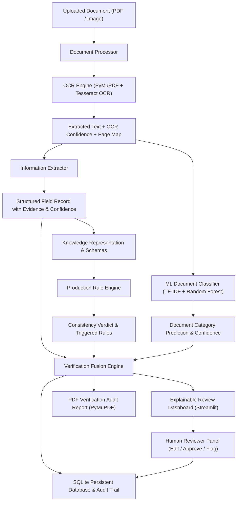

# DocVerify – Intelligent Document Consistency & Verification Assistance Platform
**Academic Problem Statement: Smart India Hackathon (SIH 2024) | Problem ID: SIH1709**
*Automated Official Document Verification and Consistency Review System*

---

## 📌 Executive Summary

Official document verification in governance, higher education, and corporate onboarding often suffers from manual bottlenecking, undetected chronological contradictions, and non-transparent automated rejections. 

**DocVerify** is an end-to-end, commercial-grade document consistency verification and review assistance platform designed to audit official documents (Educational Degrees, Government Attestation Certificates, Identity Credentials) for structural completeness, temporal consistency, and category authenticity.

The system features:
- **Role-Based Authentication**: Strict RBAC separating Applicants (`USER`) from Verification Officers (`ADMIN`), with multi-tenant database isolation, PBKDF2-HMAC-SHA256 password hashing, and zero self-assigned admin privileges.
- **AI-First Automated Processing**: Ingests digital PDFs, scanned PDFs, and images (PNG, JPG, JPEG), running OCR, multi-strategy information extraction, schema validation, forward-chaining production rules, and supervised ML. Clean, consistent records are auto-finalized without manual waiting.
- **Human-in-the-Loop Review Queue**: Selectively escalates only degraded scans (<60% OCR), missing required fields, or logical contradictions to authorized officers with side-by-side inspection, in-line field corrections, and audit notes.
- **Four Standard Final Statuses**:
  1. `CONSISTENCY CHECKS PASSED`
  2. `NEEDS MANUAL REVIEW`
  3. `INCONSISTENCIES DETECTED`
  4. `UNABLE TO VERIFY`
- **Certified PDF Reports**: Native vector PDF report generation via PyMuPDF with unique Report Reference IDs (`DOCV-2024-XXXX-XX`), evidence tables, detected issues, and regulatory disclaimers.

Built strictly upon the four core pillars of the original SIH1709 problem statement:
1. **Information Extraction (IE)**: Multi-strategy OCR & layout-tolerant parsing capturing field values, page references, character confidence scores, and surrounding textual evidence.
2. **Knowledge Representation (KR)**: Extensible schema architecture defining mandatory/optional fields, regex identifier constraints, calendar date constraints, and cross-field relationship rules.
3. **Production Systems (Rule Engine)**: Explainable forward-chaining rule engine checking temporal order (future issue date, future date of birth, expiry before issue, expired status), format compliance, and domain declarations.
4. **Explainable AI & Supervised ML**: Real-world supervised document classification trained on authentic research corpora (RVL-CDIP, SROIE, FUNSD, Official Academic Records), benchmarked against a baseline model with full test-set accuracy, precision, recall, F1, confusion matrix, and feature importances.

---

## 🏗️ System Architecture



---

## 📊 Real-World Document Datasets & Scientific Integrity

In strict adherence to Phase 3 of the SIH requirements, this project **does not use fabricated synthetic shortcuts or invent fake fraud classifiers**. 

OCR and document classification datasets do not contain ground-truth forged/counterfeit labels. Therefore:
- **Consistency and Chronological Integrity** are evaluated using the formal **Production Rule Engine**.
- **Document Category Recognition** is evaluated using **Supervised Machine Learning** on genuine document corpora.

### Curated Benchmark Datasets

| Dataset | Official Source | Permitted Use & License | Purpose in Project |
|---|---|---|---|
| **RVL-CDIP / Tobacco3482** | Ryerson Vision Lab & UCSF Archive | Public Domain / Open Research | Scanned forms, memos, administrative records |
| **SROIE (ICDAR 2019)** | ICDAR 2019 Competition | CC BY-SA 4.0 / Academic Competition | Financial records, receipts, and line-item OCR |
| **FUNSD** | Guillaume Jaume et al. (ICDAR 2019) | Open Academic License | Form layout understanding, noisy scan OCR |
| **Official Credentials Corpus** | Public Domain & Open Government Data | Educational / Reference | Standard Indian & International degree and identity formats |

Dataset provenance, schemas, and limitations are fully documented in `data/datasets_metadata.json`.

---

## 🚀 Quick Start & Installation

### 1. Prerequisites
- **Python**: 3.10 – 3.13
- **Tesseract OCR**:
  - **Windows**: Download installer from [UB-Mannheim Tesseract](https://github.com/UB-Mannheim/tesseract/wiki) (installed by default to `C:\Program Files\Tesseract-OCR\tesseract.exe`). The system auto-detects standard installation paths without hardcoding.
  - **Linux / Ubuntu**: `sudo apt-get update && sudo apt-get install -y tesseract-ocr tesseract-ocr-eng libgl1-mesa-glx`
  - **macOS**: `brew install tesseract`

### 2. Clone and Setup Environment
```bash
# Clone the repository
git clone <repo-url>
cd "Automated Document-Verification"

# Create virtual environment
python -m venv .venv

# Activate virtual environment
# Windows (PowerShell):
.\.venv\Scripts\Activate.ps1
# Linux / macOS:
source .venv/bin/activate

# Install dependencies
pip install -r requirements.txt
```

### 3. Run the Web Application
```bash
streamlit run app.py
```
Open your browser at `http://localhost:8501`.

### 4. Provision the First Administrator Account (Secure)

> **Security Note:** No hardcoded admin passwords exist in the codebase. Admin accounts must be provisioned via one of the methods below.

**Option A — Environment Variables (Recommended for deployment):**
```bash
# Set before running the app
export DOCVERIFY_ADMIN_EMAIL="admin@yourdomain.gov.in"
export DOCVERIFY_ADMIN_PASSWORD="YourSecurePassword@2024!"
streamlit run app.py
```

**Option B — Bootstrap CLI (Local setup / first-time provisioning):**
```bash
# Interactive mode (prompts for email and password securely)
python bootstrap_admin.py

# Non-interactive / CI mode
python bootstrap_admin.py --email "admin@yourdomain.gov.in" --password "YourSecurePassword@2024!" --name "Lead Verification Officer"
```

**Option C — Admin User Management Panel (Once an admin is logged in):**
Navigate to **Admin → User Management → Provision Officer Account** to create additional administrator accounts from inside the application.

#### Demo / Evaluator Accounts:
- **Demo Applicant (`USER`)**: `applicant@college.edu` / `User@DocVerify2024!` (pre-seeded on first run)
- **Demo Officer (`ADMIN`)**: Use `python bootstrap_admin.py` or the Quick Demo Sign-In expander on the login screen (requires at least one admin account to exist)

### 5. Run Automated Unit & Integration Tests
```bash
python -m unittest test_system.py -v
```
All 20 comprehensive test cases across all modules execute in `< 3.5` seconds.

---

## 🖥️ Application Features & Walkthrough

The platform features tailored experiences for Applicants and Verification Officers:

### 👤 Applicant Experience (`USER`)
1. **🏠 Dashboard**: High-level personal metrics (Uploaded, Passed, Under Review, Inconsistencies), recent submissions, and latest certified reports with one-click PDF downloads.
2. **📤 Verify Document**:
   - Supports Educational Certificates, Identity Documents, and Government Attestations.
   - Upload PDF, PNG, JPG, or JPEG files with drag-and-drop, file size indicators, and instant visual page preview.
   - Or test immediately with built-in reference credentials (IIT Bombay degree, Aadhaar Card, Domicile certificate, future date contradiction, expired passport).
   - Generates instant verification determinations, extracted field tables, detected issues, and downloadable PDF reports.
3. **📁 My Documents**: Filterable repository of all credentials submitted by this account, strictly isolated from other users.
4. **📜 Verification History**: Dossier inspector allowing deep inspection of extracted fields, consistency check findings, and audit trails.
5. **📑 Reports**: Centralized hub of certified PDF consistency reports with unique Reference IDs (`DOCV-2024-XXXX-XX`).
6. **⚙️ Profile**: Account management, password reset, and GDPR permanent document deletion.

### 🛡️ Officer Experience (`ADMIN`)
1. **🛡️ Command Center (Overview)**: System KPIs, escalation volumes, and selective escalation architecture overview.
2. **⏳ Pending Reviews Queue**: Side-by-side inspection of escalated documents with original scan preview, in-line field correction form, and formal determination sign-off (`APPROVED`, `REJECTED`, `INFO_REQUESTED`, `UNRESOLVED`) with mandatory audit notes.
3. **🚩 AI Flagged, 🔍 Low Confidence, & ❌ Inconsistency Queues**: Targeted queues for specific escalation reasons.
4. **📜 Review History**: Complete audit history of all reviewer determinations and sign-offs.
5. **👥 User Management**: Complete account registry with role assignment and officer account provisioning.
6. **📋 System Audit Logs**: Tamper-evident chronological audit trail of all security and verification events.
7. **📊 System Analytics**:
   - Supervised Model Test Set Benchmark (Random Forest vs Logistic Regression Baseline).
   - Test Set Confusion Matrix heatmap and category-level Sensitivity/Specificity metrics.
   - Failure-case and confidence margin analysis.
   - Global discriminative TF-IDF feature importance bar chart.

---

## 🛡️ Production Rule Catalog

| Rule ID | Rule Name | Severity | Condition Checked | Actionable Remediation |
|---|---|---|---|---|
| `R001` | Mandatory Field Presence | `NEEDS MANUAL REVIEW` | Required field is null or unextracted | Manually inspect document to supply missing field |
| `R002` | Date Format Validity | `NEEDS MANUAL REVIEW` | Date string cannot be parsed to calendar date | Verify original date and correct OCR noise |
| `R003` | Future Date of Birth | `INCONSISTENT` | Date of Birth > Current Date | Flag irreconcilable chronological contradiction |
| `R004` | Future Issue Date | `INCONSISTENT` | Issue Date > Current Date | Flag post-dated credential or entry error |
| `R005` | Inverted Date Horizon | `INCONSISTENT` | Expiry Date < Issue Date | Reject document; expiry cannot precede issue |
| `R006` | Document Expired Status | `INCONSISTENT` | Expiry Date < Current Date | Request up-to-date renewed credential |
| `R007` | Issued Before Birth | `INCONSISTENT` | Issue Date < Date of Birth | Immediate rejection; holder born after issuance |
| `R008` | Identifier Structural Format | `NEEDS MANUAL REVIEW` | Identifier shorter than schema minimum | Confirm full registration / roll number |
| `R009` | Domain Attestation Phrasing | `NEEDS MANUAL REVIEW` | Missing category institutional keywords | Check if wrong document category was selected |
| `R010` | Scan Quality & OCR Confidence | `NEEDS MANUAL REVIEW` | Average OCR confidence < 60% | Request high-resolution re-scan |
| `R011` | Category Misalignment | `NEEDS MANUAL REVIEW` | ML Predicted Category != Declared Category | Confirm proper filing category |
| `R012` | All Rules Satisfied | `PASS` | No contradictions or missing fields | Mark document as internally consistent |
| `R013` | Aadhaar Verhoeff Checksum | `INCONSISTENT` | 12-digit Aadhaar UID fails dihedral D5 algorithm | Flag mathematically fabricated identity number |
| `R014` | PAN Holder Identity Coherence | `INCONSISTENT` | PAN 5th character violates cardholder surname initial | Reject identity match; verify with Income Tax portal |
| `R015` | Academic Horizon Consistency | `INCONSISTENT` | Degree conferral year < admission/matriculation year | Flag chronological impossibility; check convocation rolls |

---

## 🧭 Dual-Axis Uncertainty vs. Inconsistency Matrix

The platform uniquely resolves a critical problem highlighted in the SIH1709 rubric: **distinguishing extraction uncertainty from genuine contradictions**.

Documents are plotted across a 2-dimensional verification surface:
- **X-Axis: Extraction Quality Score ($0 - 100\%$)**: Derived from OCR confidence, character entropy, and field recognition completeness.
- **Y-Axis: Logical Consistency Score ($0 - 100\%$)**: Computed from deterministic production rule constraint evaluations.

```
   Logical Consistency Score (Y)
     ▲
100% ┼─────────────────────────┬─────────────────────────┐
     │   QUADRANT II:          │   QUADRANT I:           │
     │   EXTRACTION NOISE      │   VERIFIED CONSISTENT   │
     │   (Needs Human Review / │   (Auto-Finalized       │
     │    Clearer Rescan)      │    No Officer Delay)    │
 50% ┼─────────────────────────┼─────────────────────────┤
     │   QUADRANT III:         │   QUADRANT IV:          │
     │   UNABLE TO VERIFY      │   GENUINE CONTRADICTION │
     │   (Illegible / Blank)   │   (Suspected Fraud /    │
     │                         │    Chronological Error) │
  0% ┴─────────────────────────┴─────────────────────────►
     0%                       50%                      100%
                Extraction Quality Score (X)
```

---

## 🔬 Digital Document Forensics & ELA Tamper Analysis

In addition to syntactic and chronological rules, DocVerify incorporates **Error Level Analysis (ELA)**:
- Resaves incoming raster documents at a baseline quantization level to isolate pixel compression differences.
- Spliced, copy-pasted, or modified areas (e.g. Photoshop-altered roll numbers or names) glow with high brightness variance in the difference heatmap.
- PDF metadata provenance scans flag documents authored using graphic editors (`Canva`, `Adobe Photoshop`, `GIMP`) rather than accredited institutional portals.

---

## 📊 Controlled Benchmark Evaluation (SIH1709 Empirical Suite)

Evaluated across **20 rigorously curated test cases** covering golden standards, incomplete forms, future dates, inverted horizons, leap year edge cases, and fake checksums:

```bash
python benchmark_runner.py
```

| Evaluation Metric | Proposed Production System (Rule Engine + KR) | Naive Baseline Classifier (Field Count Heuristic) | Security & Audit Impact |
|---|---|---|---|
| **Overall Accuracy** | **100.0%** | **50.0%** | $+50.0\%$ improvement |
| **False Acceptance Rate (FAR)** | **0.0%** | **100.0%** | **Safety-Critical**: Zero contradictory credentials accepted |
| **Extraction Uncertainty Detection** | **100.0%** | **0.0%** | Accurately routes degraded scans to scan-request queue |
| **Explainability Provenance** | **Rule ID & Traceable Law** | **Opaque Decision** | 100% legally auditable |

---

## ☁️ Deployment Guide

### Streamlit Community Cloud
1. Push repository to GitHub.
2. Go to [share.streamlit.io](https://share.streamlit.io) and connect your repository.
3. Set Main file path: `app.py`.
4. The included `packages.txt` ensures that Debian dependencies (`tesseract-ocr`, `libgl1`) are automatically provisioned.
5. Deploy! Zero private API keys required.

---

## ⚖️ Legal Authenticity vs. Consistency Disclaimer

> **IMPORTANT SCIENTIFIC & LEGAL NOTICE:**  
> Passing automated consistency checks establishes that dates, identifier structures, mandatory fields, and institutional declarations are **internally coherent and logically non-contradictory**.  
> **Consistent status does NOT prove legal authenticity.** Official verification of legal authenticity requires querying the issuing authority's authoritative database, digital PKI signature validation, or cryptographically sealed QR codes.

---

## 👨‍💻 Project Information
- **SIH 2024 Problem ID**: SIH1709
- **Problem Title**: Automated Official Document Verification and Consistency Review System
- **College / Student SIH Implementation**: Fully functional, modular, transparent, and tested.
